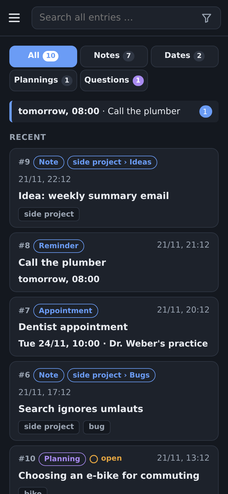
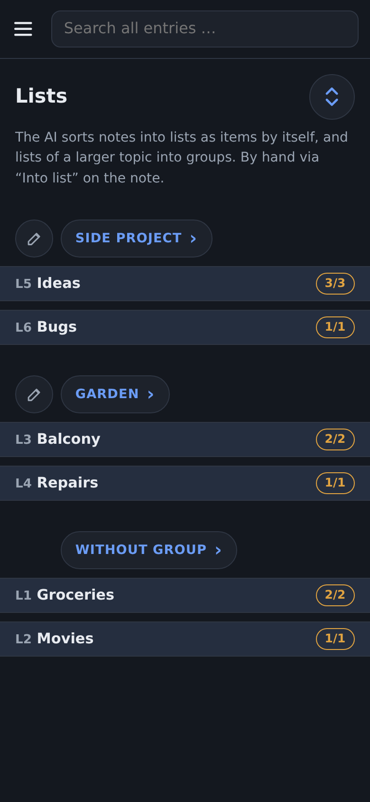
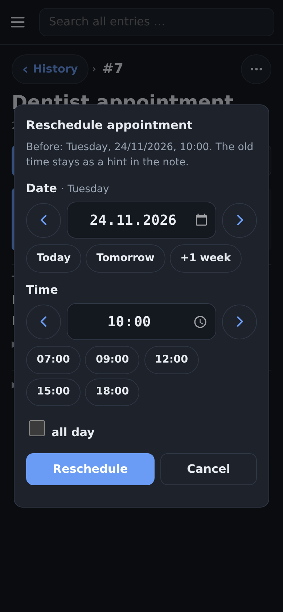

# pebble-webhook

Self-hosted backend for the **Pebble Index 01** voice ring. It receives recordings via webhook, transcribes them with OpenAI and turns them into notes, appointments or research plannings. An AI sorts everything into groups and lists; a mobile web app (PWA, English or German) shows the history, sends web push notifications and lets you answer follow-up questions.

One Go binary: webhook, worker, SQLite and web app. No queue, no second database.

## Features

- **Notes** with key facts, hints and list items; **appointments** with reminders (web push)
- **Plannings**: web research in rounds, continued by voice or text, with open questions
- **Lists and groups** sorted by the AI; tags, full-text search, trash with restore; new entries marked across all devices
- **Memory**: the AI learns names, terms and sorting rules you confirm
- Optional one-way export to a **Joplin** server
- Built-in **MCP server** with OAuth: connect Claude, ChatGPT & co., read lists and tick items off from AI chats
- **English or German** – UI, messages, push and MCP answers, and the texts the AI writes; chosen in the setup wizard (preset from the browser), changeable under Status → Configuration
- Passkey login (new devices with a 4-digit code), setup wizard, settings with explanations and validation, **themes** (day/night, colour palettes) and **updates** in the web app

## Screenshots

Demo data, English UI, mobile, dark mode.

| History | Menu | Lists | Note |
|---|---|---|---|
|  |  |  |  |
| **Planning** | **Reschedule** | **List** | **Theme** |
|  |  |  |  |

## Quick start

On a Debian/Ubuntu server with systemd:

```bash
curl -fsSL https://raw.githubusercontent.com/dirdante2/pebble-webhook/main/install.sh | sudo bash
```

The installer prints a link to the setup wizard. Put the service behind an HTTPS reverse proxy (passkeys need HTTPS), enter your OpenAI key and the public address, then create your first passkey.

## Documentation

- [Installation](docs/installation.md) – requirements, installer, reverse proxy, uninstall
- [Configuration](docs/configuration.md) – setup wizard and all settings
- [Pebble app](docs/pebble-app.md) – connecting the ring
- [Usage](docs/usage.md) – what the web app does
- [Updates](docs/updates.md) – update check, changelog, releases
- [MCP server](docs/mcp.md) – read lists and tick items off from Claude, ChatGPT and other AI assistants
- [CHANGELOG](CHANGELOG.md)

## Development

```bash
go test ./...
printf 'LISTEN=127.0.0.1:8080\nDATA_DIR=./lokal/data\nAUDIO_DIR=./lokal/audio\n' > lokal/env
mkdir -p lokal/data lokal/audio
PEBBLE_ENV_FILE=./lokal/env go run ./cmd/pebble-webhook serve
```

The first start runs the setup wizard (link in the log). `http://localhost` is accepted as public address for local tests.

## License

Public domain ([Unlicense](LICENSE)): anyone may use, change, share and sell it, without conditions.
