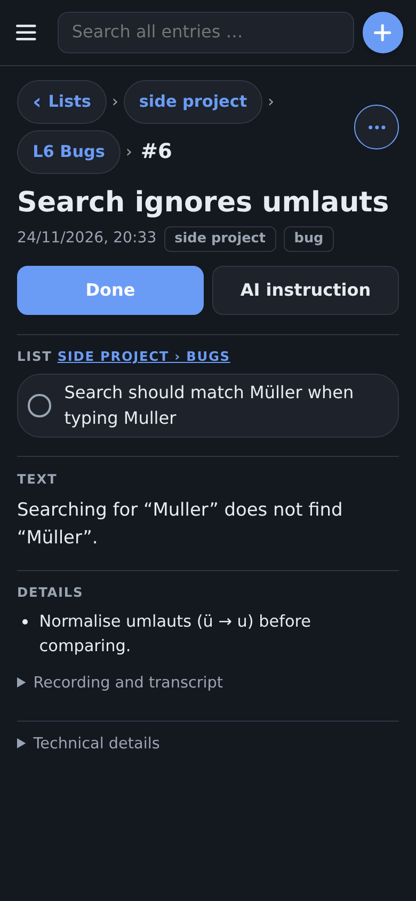
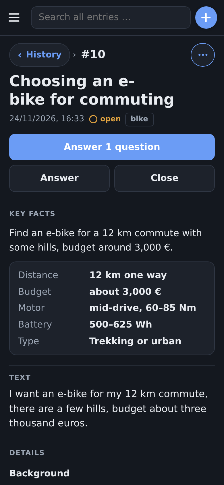

# Pebble Index Webapp

> **Hardware:** made for the [Pebble Index 01](https://repebble.com/index) voice ring by Pebble (Core Devices) – [buy it on repebble.com](https://repebble.com/index) · official website: [repebble.com](https://repebble.com/). This is an independent community project, not affiliated with Pebble.

Self-hosted backend for the **Pebble Index 01** voice ring. It receives recordings via webhook, transcribes them with OpenAI and turns them into notes, appointments or research plannings. An AI sorts everything into groups and lists; a mobile web app (PWA, English or German) shows the history, sends web push notifications and lets you answer follow-up questions.

One Go binary: webhook, worker, SQLite and web app. No queue, no second database.

## Features

- **Notes** with key facts, hints and list items; **appointments** with reminders (web push)
- **Plannings**: web research in rounds, continued by voice or text, with open questions
- **Lists and groups** sorted by the AI; tags, full-text search, trash with restore; new entries marked across all devices
- **Memory**: the AI learns names, terms and sorting rules you confirm
- **Calendar subscription** (iCal link) for Google Calendar, Apple or Outlook
- Optional one-way export to a **Joplin** server
- Built-in **MCP server** with OAuth: connect Claude, ChatGPT & co., read lists and tick items off from AI chats
- **Ring usage**: the Index 01 battery lasts about 12–15 hours of recording. Every recording is counted (seconds, notes vs. plannings, button presses) per ring ID (`#12345`); warnings at 60/80/95/100 %, forecast at constant use, ring swap with comparison
- **English or German** – UI, messages, push and MCP answers, and the texts the AI writes; chosen in the setup wizard (preset from the browser), changeable under Status → Configuration
- **Multiple users**: own encrypted database and recordings per user, admin/user roles, invite links, recovery code; nobody sees another user's data
- Passkey login (new devices with a 4-digit code), setup wizard, settings with explanations and validation, **themes** (day/night, colour palettes) and **updates** in the web app

## Screenshots

Demo data, English UI, mobile, dark mode.

| History | Lists | Note | Planning |
|---|---|---|---|
|  |  |  |  |

More: [all screenshots](docs/screenshots/) (menu, single list, reschedule, theme, ring usage).

## Quick start

On a Debian/Ubuntu server with systemd:

```bash
curl -fsSL https://raw.githubusercontent.com/dirdante2/pebble-webhook/main/install.sh | sudo bash -s -- --channel stable
```

### Docker

Image [`dirdante/pebble-index-webapp`](https://hub.docker.com/r/dirdante/pebble-index-webapp) for amd64 and arm64:

```bash
docker run -d --name pebble --restart unless-stopped -p 8080:8080 \
  -e TZ=Europe/Berlin -e PUID=1000 -e PGID=1000 \
  -v pebble-config:/config dirdante/pebble-index-webapp:stable
docker logs pebble    # link to the setup wizard
```

Or with Docker Compose ([compose.yaml](docker/compose.yaml)):

```bash
curl -fsSLO https://raw.githubusercontent.com/dirdante2/pebble-webhook/main/docker/compose.yaml
docker compose up -d && docker compose logs pebble
```

Tags, paths, `PUID`/`PGID` and updates: [installation](docs/installation.md#docker).

The installer (or the container log) prints a link to the setup wizard. Put the service behind an HTTPS reverse proxy (passkeys need HTTPS), enter your OpenAI key and the public address, then create your first passkey.

## Tips

pebble-webhook is free and open source. If it is useful to you, a small tip on [Ko-fi](https://ko-fi.com/dirdante) helps keep it going – thank you!

[](https://ko-fi.com/A7O02B4AY7)

## Documentation

- [Installation](docs/installation.md) – requirements, installer, Docker, reverse proxy, uninstall
- [Configuration](docs/configuration.md) – setup wizard and all settings
- [Pebble app](docs/pebble-app.md) – connecting the ring
- [Usage](docs/usage.md) – what the web app does
- [Updates](docs/updates.md) – update check, changelog, releases
- [MCP server](docs/mcp.md) – read lists and tick items off from Claude, ChatGPT and other AI assistants
- [CHANGELOG](CHANGELOG.md)

## Development

```bash
go test ./...
printf 'LISTEN=127.0.0.1:8080\nDATA_DIR=./lokal/data\nMEDIA_DIR=./lokal/medien\n' > lokal/env
mkdir -p lokal/data lokal/audio
PEBBLE_ENV_FILE=./lokal/env go run ./cmd/pebble-webhook serve
```

The first start runs the setup wizard (link in the log). `http://localhost` is accepted as public address for local tests.

## License

Public domain ([Unlicense](LICENSE)): anyone may use, change, share and sell it, without conditions.
