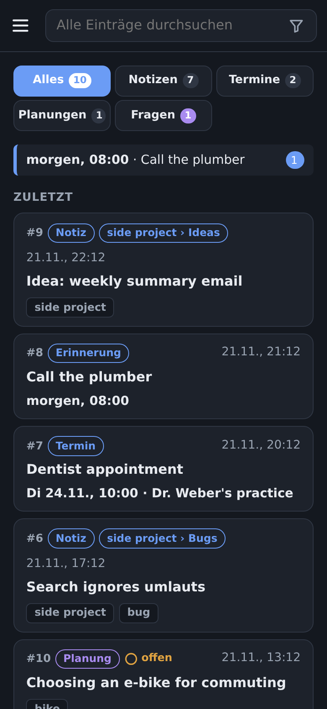
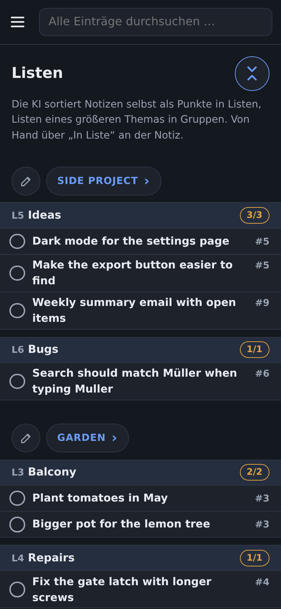
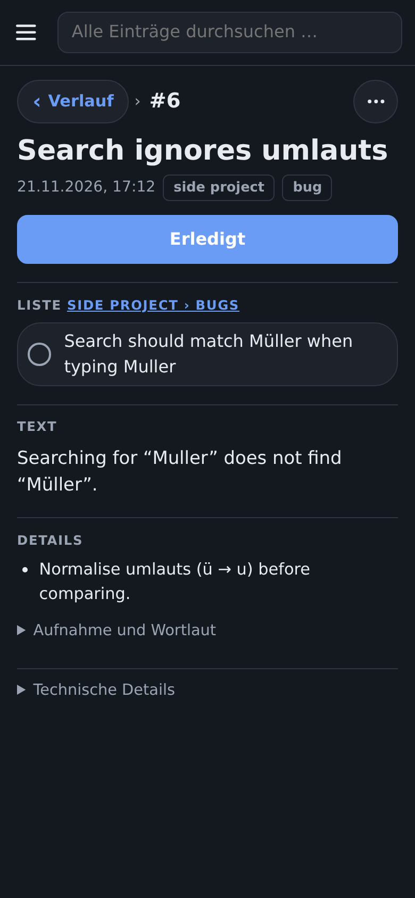

# Pebble Index Webapp

Self-hosted backend and web app for the **[Pebble Index 01](https://repebble.com/index)** voice ring. It receives recordings via webhook, transcribes them with OpenAI and turns them into notes, appointments or research plans. An AI sorts everything into groups and lists; a mobile web app (PWA, English or German) shows the history, sends push reminders and lets you answer follow-up questions.

One Go binary with SQLite, multiple users, passkey login. Independent community project, not affiliated with Pebble.

Source, docs and issues: [github.com/dirdante2/pebble-webhook](https://github.com/dirdante2/pebble-webhook)

  

## Quick start

```bash
docker run -d --name pebble --restart unless-stopped -p 8080:8080 \
  -e TZ=Europe/Berlin -e PUID=1000 -e PGID=1000 \
  -v pebble-config:/config dirdante/pebble-index-webapp:stable
docker logs pebble    # link to the setup wizard
```

## Docker Compose

Every variable and own folder is in [compose.yaml](https://raw.githubusercontent.com/dirdante2/pebble-webhook/main/docker/compose.yaml), commented out – remove the `#` to use one:

```bash
curl -fsSLO https://raw.githubusercontent.com/dirdante2/pebble-webhook/main/docker/compose.yaml
docker compose up -d && docker compose logs pebble
```

```yaml
services:
  pebble:
    image: dirdante/pebble-index-webapp:stable   # stable, beta, nightly or a fixed version like 4.1.0
    container_name: pebble
    restart: unless-stopped                      # required: saving settings restarts the service
    ports:
      - "8080:8080"                              # host:container – container side must match LISTEN
    environment:
      # TZ: Europe/Berlin                        # time zone for appointments, reminders, backups (default UTC)
      PUID: "1000"                               # owner of all data on the host (id -u) – default, keeps environment valid
      PGID: "1000"                               # group of all data on the host (id -g)
      # LISTEN: 0.0.0.0:8080                     # listen address inside the container
      # DATA_DIR: /config/data                   # databases (system.db, users/<id>/daten.db)
      # KEY_DIR: /config/keys                    # encryption key per user – not in backups, keep a copy
      # MEDIA_DIR: /config/medien                # recordings and images per user
      # BACKUP_DIR: /config/backup               # backup archives
      # PEBBLE_ENV_FILE: /config/env             # optional file with further KEY=value lines
      # OPENAI_API_KEY: sk-...                   # fixed from here and locked in the app; else set in the app
      # YOUTUBE_API_KEY: AIza...                 # fixed from here and locked in the app; else set in the app
    volumes:
      - ./config:/config                         # everything in one folder (or a Docker volume: pebble-config:/config)
      # Own folders, e.g. on a NAS or separate disks – set the matching variable above as well:
      # - /srv/pebble/data:/data                 # DATA_DIR: /data
      # - /srv/pebble/keys:/keys                 # KEY_DIR: /keys
      # - /mnt/nas/pebble-media:/media           # MEDIA_DIR: /media
      # - /mnt/nas/pebble-backup:/backup         # BACKUP_DIR: /backup
```

Put the container behind an HTTPS reverse proxy (passkeys need HTTPS) with WebSocket/SSE support, then finish the setup wizard.

## Tags

| Tag | Points to |
|---|---|
| `X.Y.Z` (e.g. `4.1.0`) | exactly that version |
| `stable`, `latest` | newest stable |
| `X.Y`, `X` | newest stable of that minor / major line (one `X` = no breaking changes) |
| `beta` | newest beta or stable, whichever is higher |
| `nightly` | newest of all channels |

Images for `linux/amd64` and `linux/arm64`.

## Configuration

| Variable | Default | Holds / does |
|---|---|---|
| `DATA_DIR` | `/config/data` | databases: `system.db` and `users/<id>/daten.db` |
| `KEY_DIR` | `/config/keys` | encryption key per user (never in backups – keep it safe) |
| `MEDIA_DIR` | `/config/medien` | recordings and images per user (`<id>/audio`, `<id>/bilder`) |
| `BACKUP_DIR` | `/config/backup` | backup archives |
| `PEBBLE_ENV_FILE` | `/config/env` | optional file with further `KEY=value` lines |
| `LISTEN` | `0.0.0.0:8080` | listen address in the container (port must match `ports`) |
| `PUID` / `PGID` | `1000` / `1000` | owner and group of all data on the host |
| `TZ` | `UTC` | time zone for appointments, reminders and backups |
| `OPENAI_API_KEY` | – | wins over the web app and is locked there |
| `YOUTUBE_API_KEY` | – | wins over the web app and is locked there |

Own folders: mount them and set the matching variable, e.g. `/mnt/nas/pebble-media:/media` with `MEDIA_DIR: /media`. Everything else is set in the web app. An optional env file `/config/env` is read as well.

## Updates and backups

- **Update:** `docker compose pull && docker compose up -d`. The app shows new versions with the pull command. When a new version starts, it first backs up the data, then migrates databases and user data by itself.
- **Restore:** in the web app under Backups (also upload). The container restarts and brings the data back; the current state is backed up first.
- **Back to an older version:** set the old image tag, then

  ```bash
  docker compose run --rm pebble wiederherstellen                # list backups
  docker compose run --rm pebble wiederherstellen <backup-name>  # the one made before the update
  docker compose up -d
  ```

Details: [installation docs](https://github.com/dirdante2/pebble-webhook/blob/main/docs/installation.md#docker).
