# Screenshots

Demo data, English UI, mobile, dark mode.

| History | Menu | Lists | List |
|---|---|---|---|
| 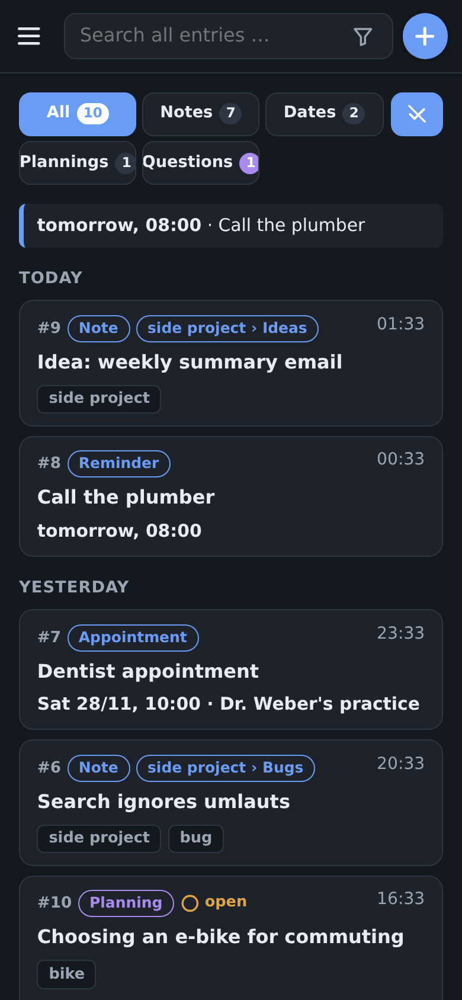 | 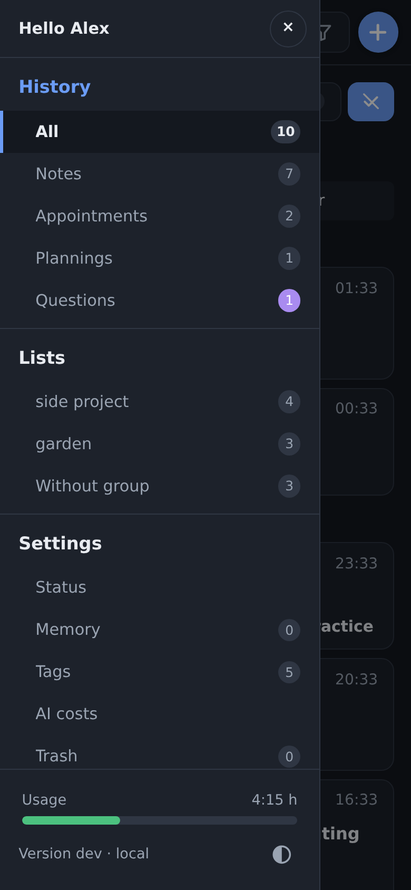 | 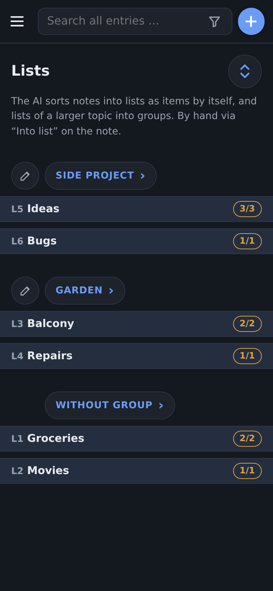 | 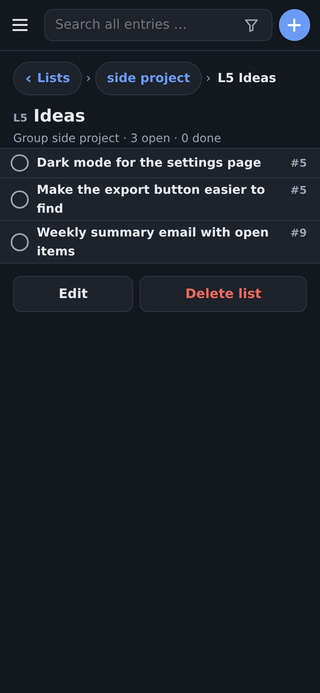 |
| **Note** | **Planning** | **Reschedule** | **Theme** |
| 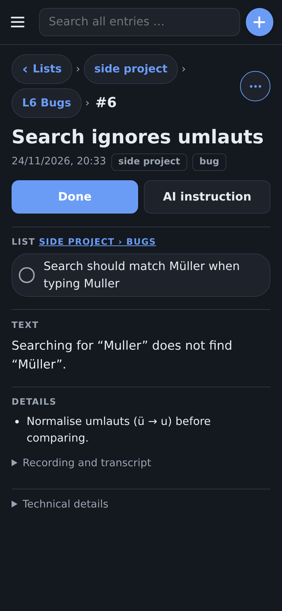 | 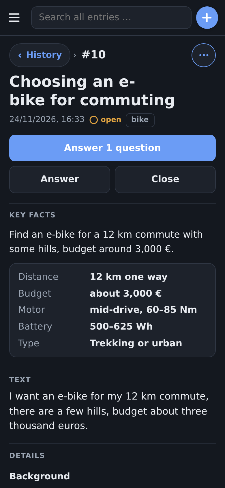 | 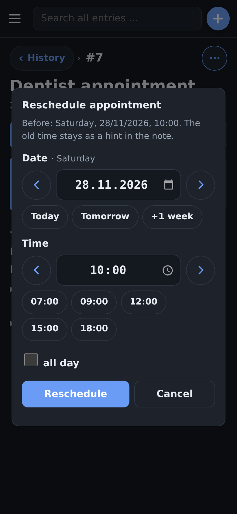 | 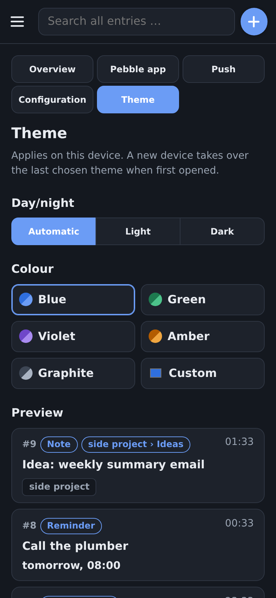 |
| **Ring usage** | **Rings compared** | **Swap ring** | |
| 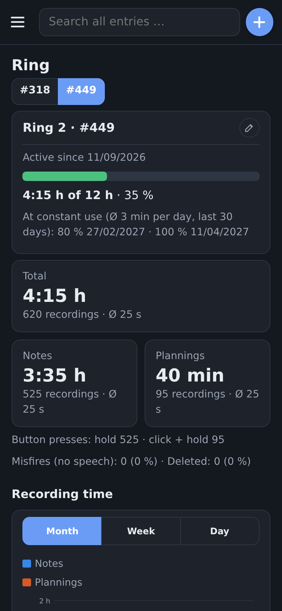 | 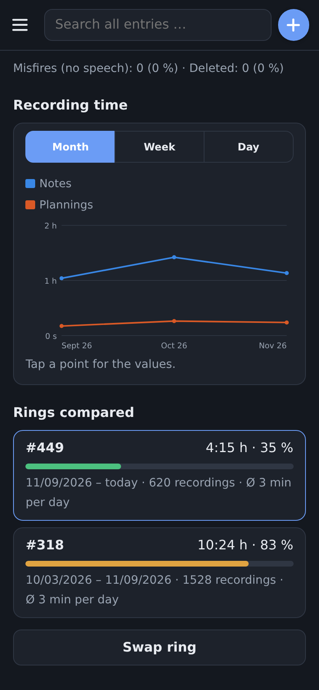 | 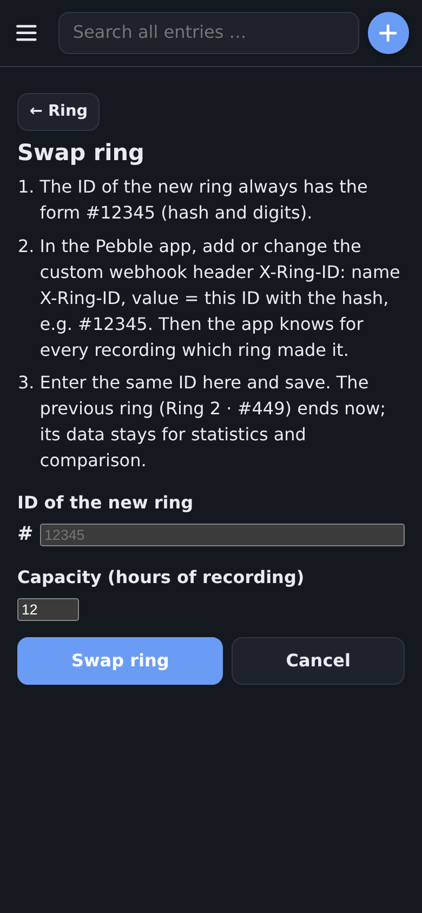 | |
