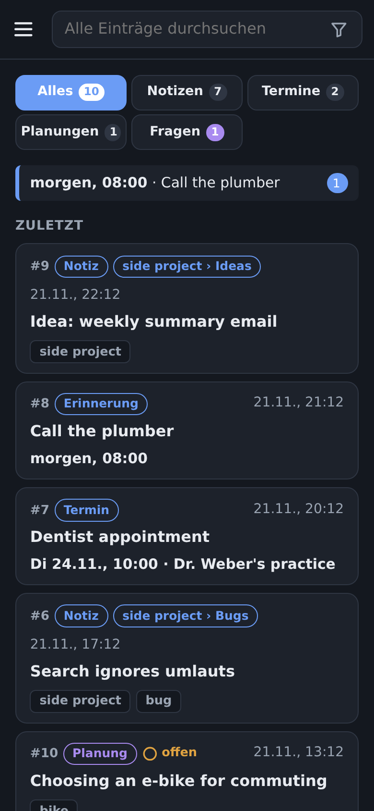
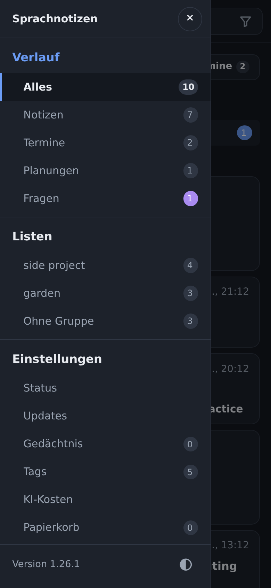
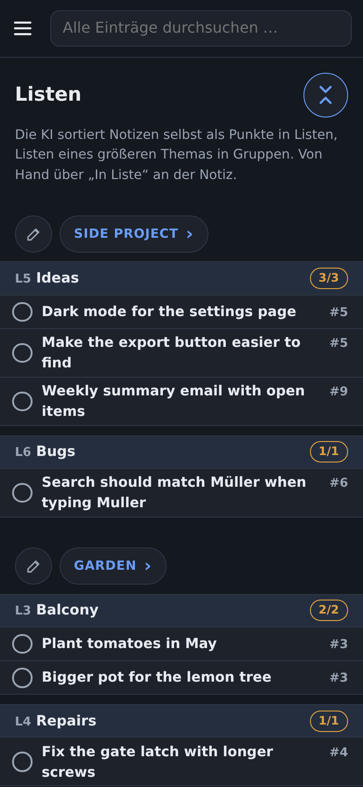
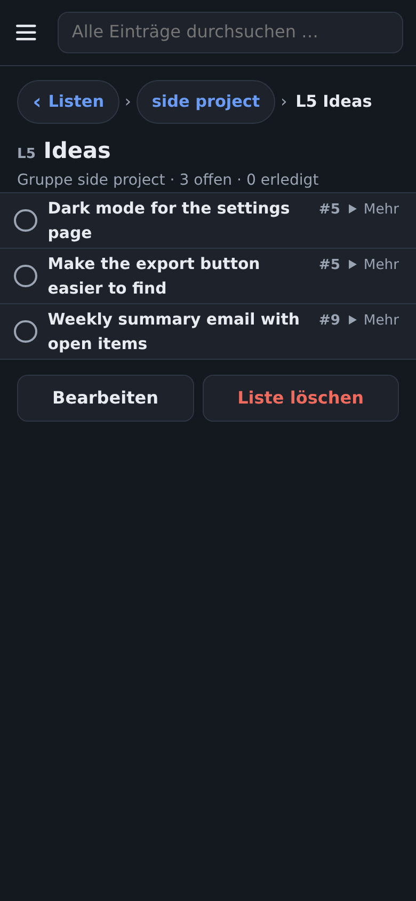
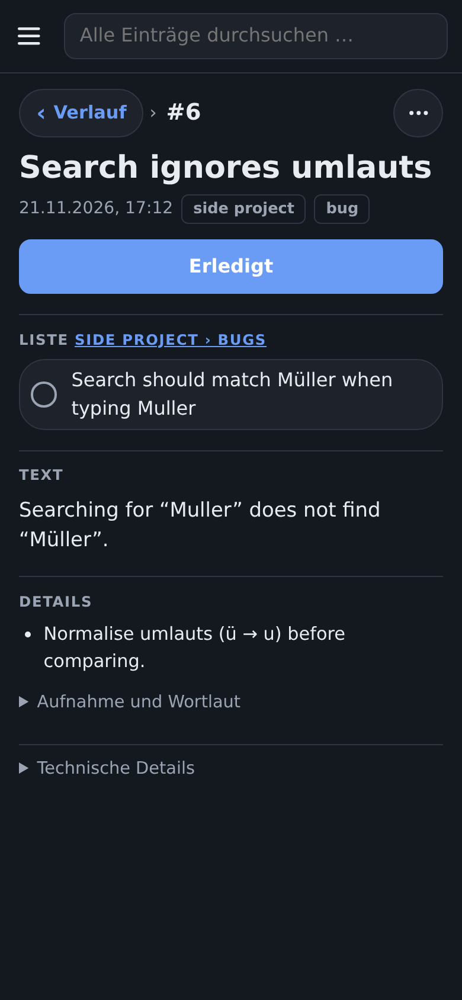
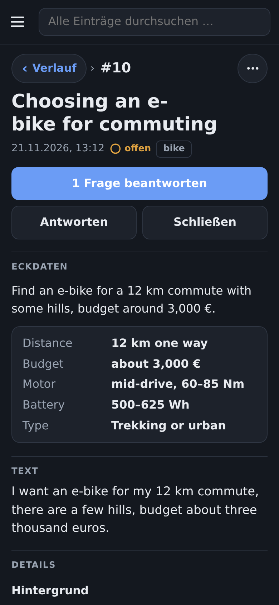
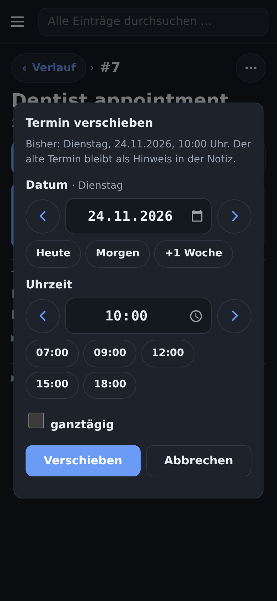
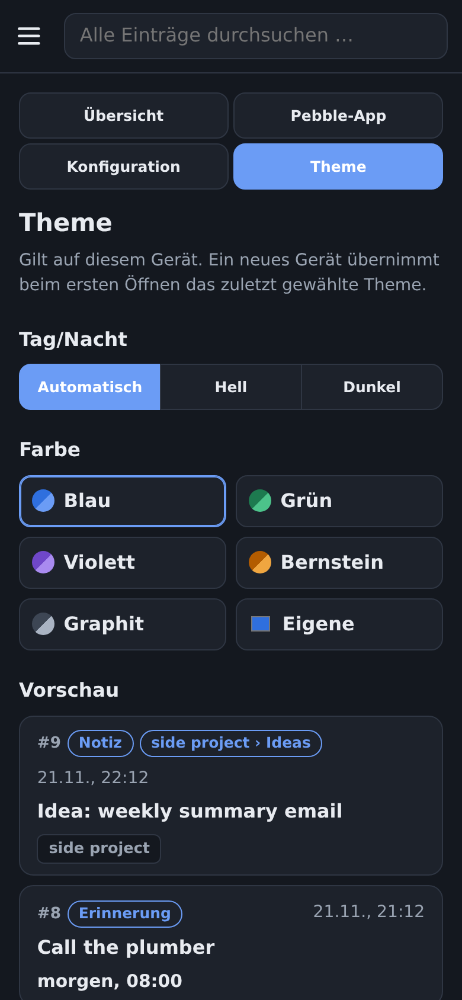

# Using the web app

Install it to the home screen (PWA) – on iPhone web push only works from there.

The menu (☰ top left; always visible on wide screens) lists the three main pages with their sub-pages and counters: grey = open entries, muted yellow = new and not yet opened since you were last here (shared by all devices). A dot on the menu button means an update or open memory suggestions. At the bottom: version, theme, and *Abmelden* as the last item.

- **History (Verlauf)**: newest entries, filters for notes, appointments, plannings and open questions. Swipe right = done, swipe left = delete. Long-press a card to select several and mark them done or delete them. The funnel in the search bar filters by tags (all selected tags must match).
- **Appointments**: every appointment has a time (07:00 if none was said; all-day only when said). Reminders arrive as web push. The line above the history shows the next appointment and how many are due within 24 hours. "Verschieben" on an appointment opens date and time pickers (‹ › for ±1 day / ±15 min, quick picks); the old time is kept as a note, the reminder comes again.
- **Detail page**: breadcrumbs on top (Verlauf › #42 or Listen › group › list › #42), one main action (Erledigt, Antworten/Schließen for plannings), everything else behind "⋯". Recording and transcript are collapsed.
- **Plannings**: the AI researches the web and answers in rounds; continue by voice or text and answer its questions.
- **Lists (Listen)**: the AI sorts notes into groups and lists; each group opens as its own page, tick items off one by one, move or delete them. The arrow icon in the title expands all open items.
- **Search**: full text over notes and plannings.
- **Settings (Einstellungen)**: status with tabs Overview (stats, notifications, devices/passkeys), Pebble app setup, Joplin (only when switched on: set up and test the connection), Configuration (? = explanation, pencil = change one value) and Theme (day/night mode, colour palette or custom colour, preview; per device, new devices take over the last choice); updates, memory, tags (tap = its entries, delete from all entries), AI costs, trash (restore deleted entries for 183 days).
- **Another device**: Status → "Weiteres Gerät hinzufügen" shows a 4-digit code (valid up to 5 minutes, only while the page is open); on the new device open the app and choose "Mit Code hinzufügen".

Detailed flows (German): [ABLAUF.md](../ABLAUF.md).

## Screenshots

Demo data, mobile, dark mode.

   

   
